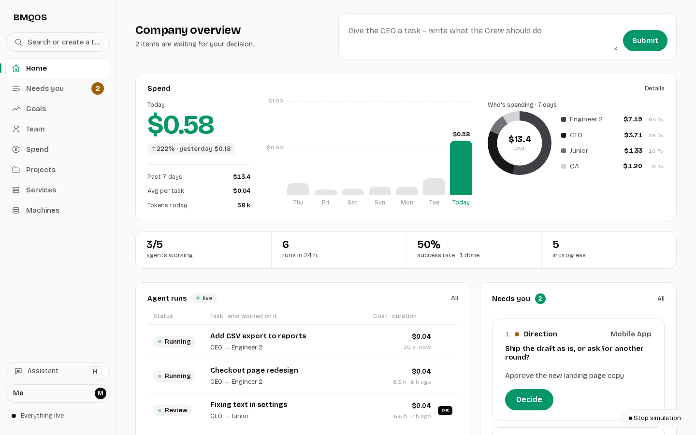

# BMQOS — AI Company Operating System

> **Quick Setup Directive:**
> Tell your agent: `install github.com/jusbenny0/bmqos`

**BMQOS** is an open-source executive control panel and operating system designed for running a company powered by autonomous AI agents. It provides a real-time command dashboard, unified inbox, agent task orchestration, sensitive action approval cards, audit logging, and service telemetry in a single interface.

BMQOS operates out of the box in **zero-dependency Demo Mode** with simulated agents and metrics, and seamlessly transitions to live operations when connected to your AI agent backends.

---

## Key Features

- 🏢 **AI Workforce Dashboard:** Track active agents, real-time token spend, current tasks, and heartbeat status.
- 🗂️ **Unified Inbox & Approval Cards:** Review and approve agent requests (deployments, expenditures, public releases) with interactive choice cards.
- 🛡️ **Tiered Security Barrier:** Multi-tier authorization model (Tier 1 reversible, Tier 2 step-up 2FA, Tier 3 confirmation) with automatic sensitive keyword escalation.
- 💬 **Live Agent Chat:** Side-panel chat with your assistant ([Hermes Agent](https://github.com/NousResearch/hermes-agent) API server): streamed replies, tool progress, and approval of risky steps.
- 🔁 **Self-Improving Team:** Agents write a retrospective after every task; useful lessons are applied to role prompts automatically, and reviewers judge screenshots and a live preview of the exact commit.
- 🧠 **Workforce & Brain Integration:** Native support for agent task queues, knowledge base search, and decision logging.
- 📊 **Telemetry & Health Monitoring:** Real-time visibility into deployments, infrastructure nodes, and external services.
- 🖥️ **Desktop Companion:** Native Linux desktop shell built with Tauri 2 (Rust) for a dedicated desktop workflow.

---

## Visual Overview & Demo Mode

BMQOS runs by default without external dependencies, allowing instant evaluation:




When backend credentials are not provided, BMQOS automatically populates realistic mock data for teams, cards, tasks, and system metrics.

---

## Quickstart

### Option 1: Automated Setup (Recommended)

Run the interactive setup wizard or tell your coding agent to run it:

```bash
git clone https://github.com/jusbenny0/bmqos.git
cd bmqos
npm run setup
# or: ./scripts/setup.sh
```

For non-interactive setup (e.g. for CI or automated agent execution):
```bash
# Local development mode (no login, bound to 127.0.0.1)
npm run setup -- --yes --mode=local

# VPS / Server mode with password authentication
npm run setup -- --yes --mode=server --auth=password --password="your-secure-password"
```
See the [Installation Guide](docs/install.md) for full argument options.

### Option 2: Docker Compose

Start BMQOS using Docker in a single command:

```bash
git clone https://github.com/jusbenny0/bmqos.git
cd bmqos
docker compose up -d
```

Open `http://localhost:3000` in your browser. Persistent database storage is preserved in the `bmqos-data` volume.

### Option 3: Manual Installation

```bash
# 1. Clone repository
git clone https://github.com/jusbenny0/bmqos.git
cd bmqos

# 2. Install dependencies (Node.js 22 or 24 required)
npm ci

# 3. Create environment configuration
cp .env.example .env

# 4. Optional: Configure authentication
# By default BMQOS runs with open access on localhost.
# To enable password protection:
# npm run hash -- 'your-secure-password'
# Edit .env and set OS_AUTH=password, OS_PASSWORD_HASH, and OS_SESSION_SECRET

# 5. Start development server
npm run dev
```

Visit `http://localhost:3000` to access the dashboard.

---

## Agent Engine (bundled in `engine/`)

BMQOS ships with its own agent workforce engine in [`engine/`](engine/README.md). The panel is the control room; the engine is the team that does the work: a CEO agent plans, builders write code in isolated git worktrees, and reviewer, security, visual and QA gates check every task before it is done. Agents run on the Claude Code CLI (optional cheap junior on Gemini via `agy`).

Two ways to run it:

- **Your own computer:** `npm run engine:install`, then `npm run start:all` starts the engine (port 3800) and the panel (port 3000) with a shared token and opens the browser. Desktop launchers for Linux, macOS and Windows are in `engine/launchers/` (see [`engine/docs/launchers.md`](engine/docs/launchers.md)).
- **Server (VPS / home server):** run the engine with `docker compose up -d` inside `engine/`, then point the panel at it with `CREW_API_URL` and `CREW_API_TOKEN`.

Talk to your company from Claude Desktop or Claude Code through the engine's MCP server (`engine/mcp/server.mts`); setup is in [`engine/README.md`](engine/README.md#mcp-server-talk-to-your-company-from-claude).

The team improves itself: every agent run ends with a one-line retrospective, and a cheap model turns the useful ones into lessons in that role's prompt and in the shared brain (`brain/team/lessons.md`). Things the agents cannot fix themselves (a missing tool, access or secret) land in `brain/team/missing.md` - your to-do list as the owner. Reviewers get evidence instead of claims: the build log, a live preview of the exact commit and 1440/390 screenshots of the changed pages.

Without the engine (no `CREW_API_URL`), the panel runs in Demo Mode with mock data.

## Configuration

BMQOS is configured via environment variables defined in `.env`. Key options include:

| Variable | Description | Default |
| :--- | :--- | :--- |
| `OS_AUTH` | Authentication mode (`none` or `password`) | `none` (open access) |
| `OS_PASSWORD_HASH` | Password hash generated with `npm run hash` | None |
| `OS_SESSION_SECRET` | Secret key for signed session cookies (32+ chars) | None |
| `OS_CONTROL` | Allow live state mutations (`1` = execute, `0` = draft only) | `0` (draft only) |
| `OS_DB` | Path to SQLite database file | `data/os.db` |
| `PORT` | Listening HTTP port | `3000` |
| `HOSTNAME` | Network interface to bind (`127.0.0.1` or `0.0.0.0`) | `127.0.0.1` |
| `CREW_API_URL` | Base URL for workforce orchestration API | None (Demo mode) |
| `HERMES_API_URL` | Hermes Agent API server URL (assistant chat) | None (Demo mode) |
| `PAPERCLIP_API_URL`| Issue tracker API endpoint | None (Demo mode) |

For complete documentation on all environment variables, consult the [Configuration Guide](docs/config.md).

---

## Architecture Overview

```
+----------------------------------------------------------------------+
|                     Client Layer (Browser / Tauri)                   |
|       Next.js 16 App Router (React 19) + Vanilla CSS Variables       |
+----------------------------------------------------------------------+
                                   |
                                   v
+----------------------------------------------------------------------+
|                       Security Barrier (Guard)                       |
|   - Same-origin CSRF validation      - Sensitive word detection      |
|   - 3-tier action gating             - Step-up 2FA (TOTP)            |
|   - LAN check (RFC 1918 / loopback)  - Constant-time secret checks   |
+----------------------------------------------------------------------+
                                   |
                                   v
+----------------------------------------------------------------------+
|                     Server Core & Business Logic                     |
|   - SQLite (Session, Cards, Audit, Chat)  - Secret Scrubber          |
|   - Audit Log with Hash Chaining          - Demo Mode Engine         |
+----------------------------------------------------------------------+
                                   |
                                   v
+----------------------------------------------------------------------+
|                         External Integrations                        |
|   - Workforce API (Tasks, Workforce) - Assistant Chat (Hermes API)  |
|   - Issue Tracker API                - GitHub (PRs, Merges)          |
|   - Deployment Services              - Infrastructure Telemetry      |
+----------------------------------------------------------------------+
```

Learn more about system design in the [Architecture Guide](docs/architecture.md).

---

## Security Model

BMQOS uses a **defense-in-depth, fail-closed** security architecture:

1. **Safe Network Defaults:** Binds strictly to `127.0.0.1` by default to prevent accidental internet exposure.
2. **Action Tiers:**
   - **Tier 1:** Reversible operations (chat messages, drafts, routine items).
   - **Tier 2:** Risky actions (code merges, infrastructure changes, sensitive cards) require step-up 2FA authentication within a 10-minute window.
   - **Tier 3:** Irreversible operations (storage purge) require a fresh TOTP code and target confirmation.
3. **Sensitive Card Escalation:** Inbound approval cards mentioning credentials, finances, or public release are automatically promoted to require 2FA approval.
4. **Secret Redaction:** Passwords, bearer tokens, and session secrets are automatically scrubbed from inbox items and logs before storage or display.
5. **Immutable Audit Trail:** All state-changing actions are recorded to SQLite with cryptographic hash chaining.

Review our full security practices in [docs/security.md](docs/security.md) and report vulnerabilities according to [SECURITY.md](SECURITY.md).

---

## Documentation

- [Installation & Setup](docs/install.md) — Detailed guide for local, server, Docker, and desktop deployments.
- [Configuration Reference](docs/config.md) — Full reference for all environment variables.
- [Architecture & Design](docs/architecture.md) — Internal system design and integration model.
- [Security Architecture](docs/security.md) — Threat model, authentication, and guard tiers.
- [Workforce Module Integration](docs/crew.md) — Orchestrating agent workforces, tasks, and company knowledge.

---

## Development & Testing

```bash
# Run unit tests
npm test

# Run TypeScript type verification
npm run typecheck

# Build for production
npm run build

# Start production server
npm start
```

Please read [CONTRIBUTING.md](CONTRIBUTING.md) before opening a pull request.

---

## License

BMQOS is open-source software licensed under the MIT License.
